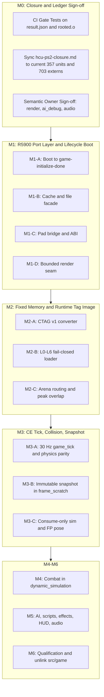

# Final milestone plan (M0–M6)

Authoritative execution specification synthesized from [indepth_milestones_plan.md](indepth_milestones_plan.md), the 17 corroborated reports in this directory, and the governing migration spec [plans/5.hcu-remake.md](../../plans/5.hcu-remake.md). This document does **not** close M0–M6 gates. Implementation must still produce the artifacts named in [§7](#7-master-verification-and-gate-checklist).

> **Initial cross-check (2026-10-20; superseded by the implementation refresh below):** this captured an earlier tree for drift comparison; `plans/5.hcu-remake.md` remains the execution authority. The closure was **357 compiled / 0 failed** (341 selected HCU sources + 16 selected PS2/port sources), **703** live rooted externals (93 PS2-service, 283 excluded-feature, 141 toolchain, 186 render), with `result.json` at `gate: open`. It selected HCU's real retail `tag_validate.c`, six schema-group files, and report sink instead of permissive PS2 validator stubs. Its `HALO_PS2` validator cap was 2 MiB, making the claims bitmap 262,144 bytes; this is not adequate for retail gameplay tag images. The ELF SHA-256 was `899454f080669be663e2496d393ef7d5e52248707ed0bfd2ee8f0b90e1a6b2ea`; file-backed sections were **2,020,510** bytes and `.bss` **9,639,192** bytes. Memory placements were candidate rather than parent-arena runtime evidence. `ps2_cache.c` rejected unsupported Xbox cache requests synchronously; no writable PS2 filesystem was mounted. The `HALO_PS2` input path avoided the Xbox debug-keyboard/rumble worker; remaining generic threads required call-site review. `main.c` emitted the M1 UI-request marker; `game.c` emitted the M2 UI-map-loaded marker only after successful `scenario_load`. The M1 probe had not reached guest execution. At that point M2 had a host-only CTAG v1 envelope/relocator and HP2 map-pack helper, but no retail schema-aware converter or arena-backed HP2 loader. Historical `ps2_platform_audit.json` is not regenerated in-tree.

> **Implementation refresh (2026-10-20; compare against the execution plan before acting):** the current closure is **358 compiled / 0 failed** (341 selected HCU sources + 17 selected PS2/port sources). The CTAG decoder and mount seam are present, but `ps2_cache_mount_ctag` is explicitly force-rooted by closure tooling and the registered map-loader callback has no production parent startup registration; ELF reachability is not runtime map-load evidence. The parent `src/stream/ctag_mount.c` now owns arena lifetime for an HP2-sourced payload and is host-tested with actual parent HP2 and HCU cache code, but it is not yet wired into the play startup path or a complete transactional BSP/tag loader. Current ELF SHA-256 is `81208465ad10f35a950bfde031bed2e8fec1bc941a89c79315af1e169173d24e` (text/data/BSS 1,924,344 / 99,024 / 9,639,296 bytes); no current-hash guest execution evidence exists because PCSX2 exited before guest launch in the available environment. The previous `e4cb8...` M1 markers are historical and must not be attributed to this ELF. CE cache bounds query provider capacity, but PS2 still defaults to a 2 MiB bootstrap cache and no production arena owner binds larger cache/BSP/validator-scratch spans. The retail schema-aware converter and 24-map conversion audit now exist; animation-data range audits also exist. HP2 readers reject duplicate/noncanonical tags and overlapping metadata/payload extents, and parent HP2 section reads roll back their entry mark on failure. M2 is nevertheless incomplete: full-map storage/arena sizing, production HP2/DVD-to-HCU registration, BSP ownership/relocation and CE surface-query parity, whole-map rollback/unload, and successful guest map load remain open. `plans/5.hcu-remake.md` remains the execution authority; use its investigation-guided priority table to turn these findings into milestone work and gates.

> **M1 host-environment update (2026-10-20):** a fresh `--stage m1-boundary` attempt with Qt's `offscreen` backend exited before guest execution (PCSX2 status 127; this AppImage has no offscreen plugin). xcb also cannot connect, and Xvfb's socket path is unavailable in the sandbox. Do not treat these launch failures as guest or M1-pass evidence.

> **M2 section-read rollback update (2026-10-20):** `halo-ps2`'s parent `world_load_section` now rolls its arena back to the entry mark on payload-read failure, scratch exhaustion, and CRC/decode failure; its new host regression verifies successful output retention and failure rollback. This closes the section-level leak identified in the failure audit only. It does not close whole-map L0–L6 rollback, arena ownership, HP2/DVD-to-HCU mounting, or guest loading.

> **Current implementation delta (2026-10-20; evidence refresh only):** the execution plan has since advanced beyond the implementation refresh above. `plans/5.hcu-remake.md` reports 359 compiled / 0 failed, 706 live rooted externals, and ELF SHA-256 `b3f59aa6efdc444f181b000708a8d0fc12247942c63a886c26fe838cf4aa4da7`. The CTAG mount path is linked; unlike the earlier force-root-only CBSP decoder, CBSP materialization is now reachable through CE `cache_file_read` when the exact encoded BSP file extent is requested. This is still not production loading: no parent HP2/DVD caller mounts the CBSP section, binds the required tag/BSP/validator arenas, or owns transactional map load/unload. Updated evidence is in [`hcu-ps2-closure.md`](../hcu-ps2-closure.md), [`retail-bsp-cbsp-audit-current.json`](../reports/retail-bsp-cbsp-audit-current.json), [`retail-ctag-compaction-audit-current.json`](../reports/retail-ctag-compaction-audit-current.json), [`retail-ctag-schema-footprint-current.json`](../reports/retail-ctag-schema-footprint-current.json), and [`retail-map-minimum-working-set-current.json`](../reports/retail-map-minimum-working-set-current.json). These audits strengthen—not close—the same P0 M1 guest-boundary and M2 capacity/production-loader priorities. In particular, preserve animation-data externalization as an unqualified candidate: its range inventory shows noncontiguous source spans and requires accessor/lifetime/DMA-latency validation before any capacity claim. `plans/5.hcu-remake.md` remains authoritative for steps and gates.

> **Paired BSP-owner evidence update (2026-10-20):** parent [`ctag_mount_hp2_with_bsp`](../../src/stream/ctag_mount.h) now composes the real HP2 section reader with HCU's cache and CBSP decoder: it requires CTAG/CRNG/CBSP, retains all three in one arena transaction, materializes the BSP only at its exact source extent, and unmounts/rolls back the mark if CBSP validation fails. The focused host integration suite passes (15 tests plus 4 subtests across loader/converter coverage). This corrects the earlier characterization that no parent HP2 path can mount CBSP. It remains a host-tested component rather than a production path: there is no startup registration, one active CBSP is supported (not every BSP in a full map), arena bindings and full-map transaction/unload are absent, and no guest map/BSP load has been observed. Follow the updated M2 acceptance in `plans/5.hcu-remake.md`; this report remains supporting evidence only.

> **CBIX multi-BSP implementation update (2026-10-20):** the implementation has replaced that one-section mount with a CBIX catalog and exact-extent lazy selection. The parent now keeps CTAG/CRNG/CBIX in the map arena, reads one matching CBSP into a disjoint scratch arena, and releases it after HCU materializes that BSP. The HCU callback seam and host fixture cover two BSP extents, invalid second payload rollback, and first-BSP reload. The retail packer now supports `--include-all-bsps`; only the single-BSP Blood Gulch package has been exercised end-to-end. Current closure/ELF is 359/0, 706 externals, hash `a4b332b78c57bd5455721313aa8668b951fc93f589e56cd22bec23f014d1e973`, `nm -u` empty. These changes improve the M2 component but do not close production startup registration, full-map arena/capacity, CE verifier relocation, or guest BSP loading. The execution plan remains authoritative.

> **All-map catalog packaging update (2026-10-20):** the `--include-all-bsps` path was run on all 24 supplied maps. [`retail-cbsp-catalog-package-audit-current.json`](../reports/retail-cbsp-catalog-package-audit-current.json) verifies 24 packages and all 82 retail BSP extents; the packages contain 349,869,456 CBSP payload bytes and total 298,973,184 HP2 bytes after section compression. This proves complete catalog/package correspondence only. Twenty-one raw BSP blocks remain over `current_bsp`, the aggregate package is not resident memory, and no guest load or production startup registration has occurred. `plans/5.hcu-remake.md` remains the execution authority.

Resume context: [plans/remake-cowork.md](../../plans/remake-cowork.md). Conflict resolutions: [_conflict_log.md](_conflict_log.md). Peer summaries: [_peer_digest.md](_peer_digest.md).

---

## 1. Governing baseline and locked architecture decisions

### Evidence pins

| Pin | Value |
|---|---|
| Parent HEAD | `a2575e957feefbdff27febedabf60590401e6bcc` |
| HCU HEAD (`ps2-port`) | `c406a4149ddebae4f45462ce4c1e8d9cce0567c2` |
| Reference `halo-local.elf` SHA-256 | `e45b4719d35450a77f2a541a7ed8abb877e5fbef495fc918539f8da91de597a2` |

Regenerate the ELF hash after every link change. M0 is committed as parent `2879895`. M1 has not passed: the retained PCSX2 log reaches `game-initialize` and has not shown `HALO_PS2_LOCAL game-initialize-done`.

### Hardware and budget version 2

The Emotion Engine has 32 MiB RDRAM. Budget version 2 in [config/memory-budget.json](../../config/memory-budget.json) commits **27,787,264** bytes across eleven regions and leaves **5,767,168** bytes unspent (total **33,554,432**). GS eDRAM (4 MiB), IOP RAM (2 MiB), and SPU2 RAM (2 MiB) are separate stores. The reserve stays unspent until a measured, versioned revision. A feature that does not fit is reduced in presentation, deferred, or rejected. It does not receive a larger store, a heap fallback, or a spend of the reserve.

| Region | Bytes |
|---|---:|
| `system_kernel` | 1,572,864 |
| `elf_static` | 2,097,152 |
| `resident_gameplay` | 6,815,744 |
| `current_bsp` | 6,291,456 |
| `texture_cache` | 4,194,304 |
| `dynamic_simulation` | 2,621,440 |
| `dma_commands` | 1,179,648 |
| `streaming` | 1,572,864 |
| `checkpoint` | 524,288 |
| `audio` | 524,288 |
| `frame_scratch` | 393,216 |
| `uncommitted_reserve` | 5,767,168 |

Standalone HCU ledger for the reference ELF ([m0_memory_ledger_auditor](m0_memory_ledger_auditor.md)): file-backed **1,892,412** bytes charged to `elf_static`, `.bss` **8,234,416** bytes, total allocated **10,126,828** bytes. `ps2_memory.o` is **6,836,256** bytes of that `.bss` in one contiguous block. Those labels are logical until parent-arena routing lands.

### Locked ownership

Production gameplay is HCU `source/`. `halo-ps2` owns the machine, GS/VU1/DMA renderer, HP2 readers, pad, timer, and boot arenas. Parent `src/game` stays a comparison fixture until M6 unlinks it. Halo-64 is the method example (manifest, prefix, renamed shell `main`, render seam in `NOTES.md`). N64 pool cuts, big-endian ABI, and omitted AI/script/sound directories do not transfer.

| Concern | Production owner |
|---|---|
| Object identity, datums, units, movement | HCU |
| Physics and collision | HCU `source/physics/` |
| Weapons, projectiles, damage, grenades, fuel rod | HCU generic tag path |
| Sword and gravity-rifle view orientation | Hybrid: HCU weapon state; halo-ps2 draw; parent pose adapter remains |
| AI, HaloScript, scenarios, local modes | HCU |
| Effect/HUD/first-person **simulation** | HCU |
| Effect sprites, HUD quads, first-person **draw** | halo-ps2 GS/VU1 from HCU decisions |
| Post-tick snapshot | HCU publishes; halo-ps2 consumes |
| Runtime CE tag image | CTAG v1 in HP2; materialized EE pointers at load |

### Execution order

Offline CTAG conversion and host loader fixtures (M2-A/B) may proceed in parallel with late M1. The first **guest** retail map load is an M2 exit, not an M1 exit.

### Resolved conflicts (C1–C5)

**C1 — Tag store shape.** Do not enlarge `HALO_PORT_TAG_CACHE_SIZE` (`0x200000` in [halo_ps2_limits.h](../../submodules/halo-ce-universal/port/ps2/include/halo_ps2_limits.h)) to retail size. [docs/reports/tag-index.md](../reports/tag-index.md): non-UI tag regions are **6.71–16.21 MiB**; tag-structure bytes after stripping model vertex/index buffers are **3.93–10.96 MiB**. Only `ui` (about **1.57 MiB** tag region) fits the bootstrap cap. Adopt **CTAG v1**: little-endian wire image with a bounded relocation table, materialized 32-bit EE pointers before `tag_get` / `tag_validate_tags`, partitioned across `resident_gameplay`, `current_bsp`, `texture_cache`, `streaming`, and `audio`. Evidence: [m2_tag_image_format_investigator](m2_tag_image_format_investigator.md), [m2_arena_capacity_auditor](m2_arena_capacity_auditor.md), [m0_memory_ledger_auditor](m0_memory_ledger_auditor.md).

**C2 — Collision authority.** Production queries are HCU `collision_test_vector`, `collision_test_pill`, `collision_move_pill`, and `collision_bsp.c`. Parent `src/game/collide.c`, `pill.c`, `collpack.c`, and `collision.hp2` stay host and `world.elf` fixtures until the [m3_collision_owner_auditor](m3_collision_owner_auditor.md) parity checklist passes, then drop from [tools/ee-world.mk](../../tools/ee-world.mk) at M6. Do not link parent collision into `halo-local.elf`.

**C3 — Boot versus map load.** Finish M1 platform services until `game-initialize-done`. Ordered next failures on the current tree: `create_mutex` inside `saved_game_files_initialize`, then `game_precache_new_map("levels\\ui\\ui")` on generated cache stubs, then `cache_file_open` returning a null handle, then M2 tag bytes and capacity. First maps on the default local path are `levels\ui\ui`, then campaign name `levels\b30\b30` when the menu selects solo. Evidence: [m1_startup_guest_path_auditor](m1_startup_guest_path_auditor.md), [m1_platform_callsite_auditor](m1_platform_callsite_auditor.md).

**C4 — Presentation seam.** The zero-initialized `render` global is **201,364** bytes (`0x31294`). **187** generated render placeholders do not advance particle lifetime or HUD timers. Follow Halo-64 [NOTES.md](../../submodules/halo-64/port/n64/NOTES.md): simulation does not read pixels, but `render.frame_index`, per-window camera work, and `interface_draw_screen` / `hud_draw_screen` still advance state. M3 publishes an immutable snapshot; the renderer may skip GS work without mutating that snapshot. Evidence: [m3_snapshot_render_auditor](m3_snapshot_render_auditor.md), [m1_platform_callsite_auditor](m1_platform_callsite_auditor.md).

**C5 — BSS deployment.** Replace the static arrays in [ps2_memory.c](../../submodules/halo-ce-universal/port/ps2/src/ps2_memory.c) with storage obtained from parent boot arenas (or agreed glue), then re-run `python3 tools/hcu_ps2_memory_audit.py`. Keep the CE object pool under `game_state` / `resident_gameplay`. Do not also charge `dynamic_simulation` until `game_state_malloc` routing is explicit. Parent Blood Gulch stream-viewer high water **6,465,536** already exceeds `current_bsp` **6,291,456** by **174,080** bytes ([docs/memory.md](../memory.md)); close that overrun before stacking CE tag and collision bytes on it.

### DMA taxonomy (do not conflate)

| Layer | Owner | Rule |
|---|---|---|
| A. Hardware chains | halo-ps2 | 16-byte DMAC quantum; `dma_commands` **1,179,648** |
| B. REF / IMAGE payloads | halo-ps2 | 16-byte address and length; `SyncDCache` before DMA |
| C. Post-tick snapshot | HCU publish | Pointer-free POD in `frame_scratch`; 16-byte row alignment |
| D. CE datums | HCU sim | 4-byte pool alignment; not DMA payloads |

`real_matrix4x3` is **52** bytes. Repack at the snapshot or VU upload boundary. `ps2_abi.c` today only probes a synthetic 16-byte `ps2_dma_record`. Evidence: [m1_dma_layout_auditor](m1_dma_layout_auditor.md), [m1_abi_layout_auditor](m1_abi_layout_auditor.md).

---

## 2. Milestone M0 — link closure and memory ledger completion

**Status:** Link slice measured and committed (`2879895`). Full M0 exit still needs tests, doc sync, and semantic owner sign-off. `result.json` `gate` stays open until that sign-off.

**Evidence:** [m0_link_closure_auditor](m0_link_closure_auditor.md), [m0_memory_ledger_auditor](m0_memory_ledger_auditor.md), [m0_runtime_ownership_auditor](m0_runtime_ownership_auditor.md).

**What already holds**

- **357** units compile (341 selected CE `source/` files + **16** `port_sources`), **0** failed. Roots: `game_initialize`, `game_tick`, `halo_shell_main`, `actors_update`, `hs_update`.
- Rooted undefined set has **0** symbols classed `simulation`, `data`, or `unclassified`. The link tool refuses to generate bodies for those classes.
- Current rooted live externals in the cross-check: **703** — **93** `ps2-service`, **283** `excluded-feature`, **141** toolchain, and **186** render. The current PS2 cache adapter owns its 13 cache entry points as explicit fail-closed functions; do not conflate these with missing map-load support.
- Simulation co-op symbols live in `ps2_coop.c` / `ps2_local.c`. Data pointers remain in `ps2_data.c`; the current PS2 closure now links the CE tag validator/schema set rather than the former permissive validation stubs.
- Identity owner = HCU datums. Collision owner = HCU physics. Parent `object_table_t` must not remain a second simulation database (enforcement is M3/M6, decision is M0).

**Remaining work**

1. Keep [tests/test_hcu_ps2_closure.py](../../tests/test_hcu_ps2_closure.py) checking `failed_count == 0`, complete compilation, and empty `simulation` / `data` / `unclassified` classes. It now also checks rooted `nm -u` and the final ELF. Refresh these checks when the current rooted closure shape changes; do not hard-code stale unit counts.
2. Keep [docs/hcu-ps2-closure.md](../hcu-ps2-closure.md) and [plans/remake-cowork.md](../../plans/remake-cowork.md) synchronized to the artifact used for each checkpoint. This document's earlier 345/726/1,892,412/8,234,416 values describe an older image and are superseded by the current-tree cross-check above; never combine measurements from different ELF hashes.
3. Prove the **15** `network_coop_note_*` excluded-feature stubs do not change simulation state while `network_coop_active()` is false (`ps2_coop.c`). They are live from gameplay sources even though the simulation `network_coop_*` API is real.
4. Semantic sign-off, not just arithmetic: grouped owners for the zeroed **`render`** global (**201,364**), **`ai_debug`** (**547,628**), and **`audio`** staging (**524,288**, zero spare at the v2 cap). Accept, gate behind debug, or relocate. Do not charge `dynamic_simulation` for the object pool while it still sits in `game_state`.

**M0 exit (remaining slice):** reviewed closure report matches the pinned artifact; no unresolved simulation symbol is a harmless stub; every live allocation is named against one hardware store and one budget region, with explicit acceptance of grouped owners that are still bootstrap BSS.

---

## 3. Milestone M1 — R5900 port layer and local lifecycle boot

**Status:** `halo-local.elf` links with no undefined symbols. PROGBITS fit `elf_static` on measured images (reference spare is on the order of **200 KiB** against the **2,097,152** cap; recompute per ELF). Guest boot has not completed the local-game lifecycle.

**Evidence:** [m1_startup_guest_path_auditor](m1_startup_guest_path_auditor.md), [m1_platform_callsite_auditor](m1_platform_callsite_auditor.md), [m1_pad_multitap_auditor](m1_pad_multitap_auditor.md), [m1_abi_layout_auditor](m1_abi_layout_auditor.md), [m1_dma_layout_auditor](m1_dma_layout_auditor.md).

Guest entry is [ps2_main.c](../../submodules/halo-ce-universal/port/ps2/src/ps2_main.c): `ps2_abi_check`, `physical_memory_allocate`, `halo_shell_main` (`shell_xbox.c` compiled with `main` renamed). Parent `engine/src/main.c` is a different ELF and is not called.

### M1-A — Guest boot through `game-initialize-done`

The retained pre-change log order reaches `game-initialize-done`, then records `file_create('custom_maps') error 0x00000002` and an unresolved `levelsuiui` path. It predates the current adapter changes. Current [ps2_edge.c](../../submodules/halo-ce-universal/port/ps2/src/ps2_edge.c) explicitly fails `CreateDirectoryA` with `ERROR_ACCESS_DENIED` because no writable PS2 filesystem is mounted; it does not create `custom_maps`. A fresh attempt against the current ELF exited before guest execution due to Qt xcb/display failure. Do not infer current guest state from the older log; rerun on a working display after platform changes.

Ordered work:

1. Confirm `custom_maps` create does not abort startup (real success, or non-fatal `file_create` / `error` policy). Do not treat a stale buffer line as the only fault.
2. Give `saved_game_files_initialize` a non-null mutex/event/thread story (`CreateEventA`, `CreateThread`, `WaitForSingleObject` are still generated). A null `create_mutex` hits `match_vassert` and `halt_and_catch_fire` before `game-initialize-done`.
3. PCSX2 via `tools/test_hcu_boot.py` / `tools/test_emulator.py` `prepare()` until the log contains `HALO_PS2_LOCAL game-initialize-done`, or the next halt names a new caller and address.
4. Update closure doc and [plans/5.hcu-remake.md](../../plans/5.hcu-remake.md) status from **that** ELF. Do not commit M1 on a boot that stops inside `game_initialize`.

`main_setup_connection` → `main_menu_load` → `main_load_ui_scenario` runs after `game_initialize` returns. That map attempt is M1-B / M2, not the M1-A marker.

### M1-B — Cache and file façade (CRITICAL cluster)

[m1_platform_callsite_auditor](m1_platform_callsite_auditor.md) identified **20** CRITICAL symbols in the original snapshot. Current delta: `port.json` selects `ps2_cache.c`, which explicitly rejects Xbox-cache operations and marks failed reads complete; map loading is still unsupported. The seven Win32 file-I/O calls and remaining synchronization/thread entry points still require call-site-backed ownership or fail-closed behavior.

| Cluster | Symbols | Live effect |
|---|---|---|
| Map lifecycle (13) | `cache_files_initialize`, `cache_file_open` / `read` / `close`, `cache_files_precache_map_*` | `game_precache_new_map` (`game.c` ~812–905) never reaches a loaded map; status stays false or asserts |
| Win32 file I/O (7) | `CreateFileA`, `ReadFile`, `GetFileSize`, `SetFilePointer`, `CloseHandle`, `FindFirstFileA`, `FindNextFileA` | Tag and save reads are zero/null |
| Spin risk | `SwitchToThread` no-op | `scenario_tags_load` can wait forever on `read_complete` if a read is shaped as “started” |

Disposition: real PS2 cache/map/file owner, or an explicit fail-closed error. The current tree has a fail-closed cache facade and explicit fail-closed Win32 file functions in `ps2_edge.c`; these do **not** load maps. `cache_file_read` sets completion flags for failed requests so no caller waits forever. Verify the live rooted symbols are owned by those implementations and not emitted in generated `ps2_platform.c`. The old `ps2_platform_audit.json` is stale and there is no current in-tree generator; replace it with current-symbol evidence or add a maintained generator before treating it as a gate.

Text `source_references` in the audit JSON scan all of `source/`, including excluded files. **526** symbols touch manifest-selected sources; **31** are text-dead; **5** are link-only. Ticket from Appendix A, but confirm relocation in `rooted.o` before treating a symbol as live.

`GetFileAttributesA`, `CreateDirectoryA`, `GetLastError`, `SetLastError`, core XInput, time, `rasterizer_initialize`, and `DirectSoundCreate` are explicitly owned by `ps2_edge.c` / `ps2_input.c` / `ps2_time.c` or fail-closed. They are not counted among generated rooted placeholders.

### M1-C — Pad bridge, ABI, DMA prep

**Pad.** `ps2_input_publish_state` is only called from `ps2_input_publish_dualshock` and the host test. Parent `pad_poll_players` ([pad.c](../../submodules/halo-ps2/engine/src/platform/pad.c)) has no callers outside its own file. Runtime parent traffic is `pad_poll` on port 0 slot 0. CE `input_frame_begin` → `input_get_device_states` sees no insertions until something publishes.

Bridge, once per simulation tick, **before** `input_frame_begin`:

- `pad_poll_players` into four `pad_sample` slots.
- For each port `0..3`, `ps2_input_publish_dualshock` (or a fully formed `XINPUT_GAMEPAD` via `ps2_input_publish_state`).
- CE port `n` is the logical player index from that array.

Face buttons travel in `bAnalogButtons`, not `wButtons`. Sticks are published at XInput scale; CE `fix_dead_zone(9000)` runs after `XInputGetState`. Parent play applies the dead zone in `pad_to_command` instead. Do not mix the two pipelines on the CE path. Four-player campaign is out of product scope; the API is four-wide for local split screen. `XInitDevices` and rumble (`XInputSetState`) remain stubs.

Keep [tests/test_hcu_ps2_input.py](../../tests/test_hcu_ps2_input.py). Add a host bridge fixture for multitap topologies (port-0 tap vs port-1 tap) and hotplug insert/remove.

**ABI.** `python3 tools/hcu_ps2_abi_host.py` must stay green. Already locked: ILP32 pointer/`long` 4, `wchar_t` 2, `object_datum` **420**, `weapon_datum` **636** (weapon at `0x1DC`, triggers `0x210`, magazines `0x258`, `game_time_last_fired` `0x278`), `projectile_datum` **552** (`target_object_index` `0x1E8`, `detonation_timer` `0x1F0`), `render_globals` **201,364**. Add `projectile.arming_time` at `0x1F8` on the next ABI edit. Pull high-value `damage.c` / `unit_datum` / `vehicle_datum` offsets into a host and R5900 golden set when M3 parity needs them. Do not treat host ILP32 agreement as Xbox MSVC proof.

**Doubles.** Closure records about **2,099** soft-double relocations (`fast_ftol`, `arctangent`, `square_root`, `power` and similar). Track with per-call-site float fixtures before swapping helpers. This gate does not block M1-A boot. It does block calling the port “EE FPU-clean.”

**DMA prep (design only until M3).** Freeze snapshot field list with M3 before extending `ps2_abi.c` past `ps2_dma_record`. Pool blocks stay 4-byte aligned (`memory_pool.c`).

### M1-D — Minimum presentation adapter

Initialize or advance the globals CE actually reads when `source/render/` is excluded:

- `render.frame_index` (particles die when unrendered longer than 15 frames).
- Particle/contrail/shadow toggles that are **R4** data (`render_particle_systems_enabled` and siblings) so a zero BSS does not silently disable systems the sim expects.
- `render_location_visible` in `ps2_edge.c` is hard-coded false; treat that as a known culling bug relative to CE, not as a finished policy, before particle tests.

Do not link full Xbox `render.c` / D3D. A callback may stay empty only after a call-graph check shows it cannot change simulation state (M1 step 5 in the remake plan).

**M1 exit:** a minimal R5900 ELF boots the CE local-game lifecycle through `game-initialize-done` and the menu setup that does not require a retail tag image; no Direct3D, DirectSound, Bink, or online-netcode relocations; PROGBITS reported against `elf_static`; cache/file symbols on the precache path are real or fail-closed, not false success. Retail `scenario_tags_load` success is M2.

---

## 4. Milestone M2 — fixed memory and the runtime tag image

**Evidence:** [m2_tag_image_format_investigator](m2_tag_image_format_investigator.md), [m2_map_conversion_auditor](m2_map_conversion_auditor.md), [m2_loader_failure_auditor](m2_loader_failure_auditor.md), [m2_arena_capacity_auditor](m2_arena_capacity_auditor.md). Contract: [docs/hcu-tag-loader-contract.md](../hcu-tag-loader-contract.md).

Today’s converter ([tools/convert_map.py](../../tools/convert_map.py)) emits three HP2 packs (`bspconv`, `objpack`, `texconv`) and does not satisfy `scenario_tags_load`. `world_load_section` validates HP2 and is the presentation path only.

### M2-A — CTAG v1 converter

Wire format (inside HP2, not raw Xbox cache):

- Little-endian image whose in-memory shape matches `cache_file_tag_header` (36 bytes, signature `'tags'`) and `cache_file_tag_instance` (32 bytes).
- Pointer fields on disk are offsets from the image base. A sorted, bounded relocation table lists every pointer field (N64 `H64M` / `element_relocate` precedent).
- Preserve absolute table index and datum salt. Dropped tags stay as `group_tag == NONE` holes when indices must remain stable.
- Strip model vertex and index pools into existing `MODL` / `BSPS`. Externalize bitmap pixels and sound samples. Do not fold tag structs into `objpack` alone.
- BSP `file_offset` / `file_size` may name an HP2 payload; `base_address` must still be a valid EE pointer when collision loads.

Runtime: after decode into the owning arena, `*(uint32_t *)(base + reloc_off) += (uint32_t)base` (null stays 0). Then the buffer matches `cache_file_tag_header_verify` and real `tag_validate_tags`. Do not leave Xbox VA `0x803A6000` or mixed offset/pointer forms in one loaded map. Do not refactor all of HCU to offset accessors.

Fixtures: synthetic tag set, then Blood Gulch. Byte-identical converter runs, valid cross-tag references, little-endian layout, render vertices and bitmap pixels not duplicated into the gameplay image. Retail bytes stay gitignored; cite [docs/reports/tag-index.md](../reports/tag-index.md) and [docs/reports/tag-payload-inventory.md](../reports/tag-payload-inventory.md) for scale.

### M2-B — Fail-closed loader (L0–L6)

Any failed step publishes **no** gameplay authority (`global_tag_instances` unset, no collision BSP, no half-registered buffers), except CE’s existing BSP-switch rollback.

| Layer | Check | On failure |
|---|---|---|
| L0 | Path, read length, no success-shaped short reads | Explicit error |
| L1 | HP2 magic, version, section table, codec, LZ4, CRC (`hp2.c`) | Do not decode |
| L2 | CTAG version, reloc bounds, region ownership | Release partial allocs |
| L3 | `cache_file_tag_header_verify` | `scenario_tags_load` → `NONE`, close file |
| L4 | Real `tag_validate_tags` (replace [ps2_data.c](../../submodules/halo-ce-universal/port/ps2/game/ps2_data.c) stubs) | Same |
| L5 | `scenario_structure_bsp_load` into `current_bsp` / declared `base_address` | `FALSE`; reload previous BSP when CE already does |
| L6 | Parent `world_load_section` + `bsp_open` for presentation packs | `NULL`; `arena_reset` so a failed load does not keep charged bytes |

`cache_file_header_verify` and BSP-tail checks now call `physical_memory_get_tag_cache_size()` instead of comparing against the `TAG_CACHE_SIZE` macro. The PS2 provider still defaults to the **2 MiB** bootstrap array; `physical_memory_bind_tag_cache` can bind a larger caller-owned span before allocation, but no production map loader does so yet. This is an ordering dependency: `ps2_main.c` calls `physical_memory_allocate` before entering the shell/menu path that selects a map, and the current binder rejects post-allocation binding. M2 must prove either one measured maximum contiguous span is reserved/bound before startup or a safe map-unload path permits later rebinding after all CE references are unpublished. The validator's per-byte claims bitmap is a separate resource: it retains its 262,144-byte bootstrap storage and requires explicitly bound caller-owned scratch for larger cache extents. `tag_validate_release_claims_buffer` returns to bootstrap scratch only after the loader unpublishes the old map and BSPs; a subsequent map must bind scratch again before validation. Until the tag cache and matching claims scratch are both reserved from and bound to measured owner regions, only `ui`-scale images can pass the runtime path.

HP2 L1 does not imply L3–L5. Duplicate section tags and overlapping payloads are gaps in `hp2.c` open; either reject them in L2 or document them as out of L1 scope.

### M2-C — Capacity and arena routing

Measured lower bounds (not proposals for new caps):

- Gameplay tag structs **3.93–10.96 MiB** after geometry strip. Bitmap payloads **18.6–56.5 MiB** and sound **11.5–164.5 MiB** are stream totals, not simultaneous EE residency. EE texture staging in the HCU bootstrap is **524,288**; v2 `texture_cache` is **4,194,304**. SPU2 RAM is **2 MiB**.
- Parent Blood Gulch packs (one conversion): BSP file **405,504**, objects about **2.3–2.4 MiB**, textures **350,208**; collision tables in a `COLL` pack **666,372**. Arena high water still exceeds `current_bsp`.
- Stream-viewer ELF can exceed `elf_static`. Close both overruns before adding CE tag and collision bytes.

Work:

1. Publish a peak-overlap table per class (`ui`, multiplayer, campaign) for permanent tags + active BSP + collision working set + texture staging + audio staging + streaming, using declared v2 limits only.
2. Route `game_state` (**3,428,352**), tag image, texture pages, sound staging, and the **262,144** `malloc_arena` off the monolithic `ps2_memory.o` BSS into caller arenas. Re-audit. `audio` has **zero spare** at 524,288 if the whole staging buffer stays charged.
3. Map load and unload return to a stable arena baseline. No `malloc` after map load (including `play_ee.c`).

**M2 exit:** load/unload of the synthetic set and Blood Gulch (and `ui` on the guest once M1-B can open a file) returns to baseline; high water fits each assigned EE region; reserve untouched; GS, IOP, and SPU2 bytes reported in their own stores; malformed images fail closed.

---

## 5. Milestone M3 — CE tick, movement, collision, and snapshot

**Evidence:** [m3_object_lifecycle_auditor](m3_object_lifecycle_auditor.md), [m3_player_movement_auditor](m3_player_movement_auditor.md), [m3_collision_owner_auditor](m3_collision_owner_auditor.md), [m3_snapshot_render_auditor](m3_snapshot_render_auditor.md), [m3_first_person_pose_auditor](m3_first_person_pose_auditor.md).

Today `WORLD_PLAY=1` in [tools/ee-world.mk](../../tools/ee-world.mk) links `play_ee.c`, `move.c`, `pill.c`, `collide.c`, `collpack.c`, combat modules, and `play_fp.c`, and wraps `objects_tick` / `fpview_*`. `halo-local.elf` contains CE physics and is not that play loop. One tick must not call both stacks.

### M3-A — `game_tick` and collision parity

Run CE `game_initialize` / `game_tick` at 30 Hz. Source order in `game.c` stays: units, AI, first-person weapons, game rules, scripts, objects. The parent diagnostic loop stays off this path.

Input is the M1-C bridge into `player_control` / `input_xbox.c`, not `pad_to_command`. Parent `mover_tick_map` matches Blood Gulch / `cyborg_mp` scalars (run 2.25, jump `0.07`, pill radius 0.2, gravity `0.0035651792`) and is the **oracle**, not the steady-state sim. CE adds stun, speed multiplier, alert seat, double-speed, and `biped_jump`. Those are in scope for full CE ownership unless a cited port exception says otherwise.

Collision production path:

- Structure: `collision_bsp_test_vector` / `collision_bsp_test_pill`.
- Gameplay: `collision_test_vector` / `collision_test_pill` / `collision_move_pill` (biped at `bipeds.c`).
- Active BSP: `global_collision_bsp_get` after M2 structure load.
- Local co-op player policy: `network_coop_player_collisions` in `ps2_coop.c`.

Parent pill is structure-only (256 features, 128 BSP depth). Host scratch is about **47,644** bytes and fits `frame_scratch`. CE scratch size is **unknown until linked**; measure it, do not invent it. Delete the `malloc` of pill scratch in `play_ee.c` from any integrated boot.

Parity: run the collision auditor’s checklist (structure vector, pill move, object/actor hits, projectile flags, underwater/media) against existing host fixtures (`tests/test_collide.py`, `test_player.py`, `test_move.py`, `test_shot.py`, `test_grenade.py`, `test_combat_targets.py`) **before** unlinking parent objects. Parent `COLLIDE_*` flags are not the CE `_collision_test_*` bits. Hit identity becomes `object_datum` handles, not `object_table_t` slots.

Movement fixtures: keep `tests/player_main.c` traces as the migration oracle; add a CE `game_tick` hash column once the bridge and BSP residency exist. Parent already shows render-schedule invariance for `mover` positions. M3 must show the same for **CE** state.

### M3-B — Immutable snapshot

No snapshot type exists beyond the M08 hybrid toy (`src/hybrid/protocol.h`) and halo-ps2 design notes. Build one after each completed `game_tick`, into caller-provided storage in `frame_scratch` (**393,216**) or another named region. One to four local players share that fixed storage. The renderer may skip or delay a frame without writing the snapshot and without allocating.

Contents (POD, no pointers into tick scratch):

| Field | Source |
|---|---|
| Generation-safe handles `(identifier << 16) \| index` | `data.c` / `object_header_datum` |
| Root transforms and node palettes | `object_get_node_matrices`; repack `real_matrix4x3` to 16-byte rows if a chain will DMA them |
| Per-player camera / viewport | CE render window inputs, stored at tick or at the presentation seam |
| First-person pose subset | Outputs of `first_person_weapons_update` (tick-frozen). Matrices refined in `first_person_weapon_render_update` are presentation unless the hash says otherwise |
| HUD work and effect **requests** | CE decisions; not live particle-pool pointers |

`cached_object_render_states` is an HCU presentation cache keyed by handles. It is not the parent table. Snapshot high water for four players is unmeasured; failing the `frame_scratch` cap fails the milestone.

Consumers: [sim/objects.h](../../submodules/halo-ps2/engine/src/sim/objects.h), skeleton, and `fpview` become read-only. `obj_render` stops treating `objects_tick` as authority. `play_ee.c` must stop rewriting biped placement on the engine table.

Invariance: hash CE gameplay state (handles, transforms, velocities, weapons/ammo, projectiles, health/shields, random, tick) across **0 / 1 / N** presentation passes. Exclude render-only and audio-only bytes. Parent `tests/test_shot.py` (presentations 0, 1, 4) is the pattern, applied to CE.

### M3-C — First person and retirement boundary

`first_person_weapons_update` runs inside `game_tick` (`game.c` ~378). `struct first_person_weapon` is **0x1EA0** bytes per local player; `node_matrices` sit at **0x108C**. Draw on Xbox requires `first_person_animations.index != NONE`. Fuel rod, and the supplied sword/gravity tags as audited, have no first-person graph: CE shows arms only. Parent `play_fp.c` currently seats fuel rod on a rocket-launcher graph (`flak_idle.h`) and drives sword/gravity from `sword_idle.h` / `carbine_idle.h` via wraps in `ee-world.mk`.

M3/M6 rule:

- CE tick outputs are the only animation authority.
- Sword and gravity orientations stay as a **presentation** adapter (the exception that survives M6).
- Delete the fuel-rod pose path. Do not synthesize a fuel-rod viewmodel.
- Do not treat parent weapon cycling in `play_fp` as CE inventory.

Governing snapshot cap (open measurement, not a new constant): CE rendered-object limits versus parent `OBJ_MAX` (1024) versus `COMBAT_TARGET_MAX` (64). Pick the cap that fits `frame_scratch` after measurement. Preserve generation so a reused slot cannot alias a stale parent index.

**M3 exit:** player movement and collision use CE records; traces match with zero, one, or many render passes between ticks; movement and snapshot bytes stay inside `dynamic_simulation` and `frame_scratch` as assigned. Parent modules remain linked only as oracles until those traces exist.

---

## 6. Milestones M4–M6 — combat, campaign surface, and retirement

These milestones were not separately investigated. They inherit M0–M3 contracts and the exit text in [plans/5.hcu-remake.md](../../plans/5.hcu-remake.md).

### M4 — Combat on the CE tag and collision owners

Link CE weapon, projectile, damage, and grenade lifecycles to the CTAG image and M3 collision. Keep source order, deterministic random streams, material/region selection, and area-of-effect filtering. `weapon_datum` is **636** bytes; `projectile_datum` is **552**. Records live in `dynamic_simulation` (**2,621,440**). Pool exhaustion fails that shot or effect and leaves the rest of the tick intact. No `malloc`, no pool growth.

Close the parent M13 ledger for all **23** audited `weap` paths, grenades, objectives, actor weapons, and vehicle/turret origins ([plans/0.native-ps2-halo-hybrid-port.md](../../plans/0.native-ps2-halo-hybrid-port.md)). Parent `shot.c` / `grenade*.c` / `combat_targets.c` (engine-slot vitals and `ACOL` rays) stay comparison fixtures until integrated traces match, then stop being production.

- **Fuel rod:** generic HCU tag path only. No bespoke parent profile and no Halo 2 pose. Missing first-person graph means arms-only.
- **Energy sword:** special melee/lunge and tag damage in marked HCU fork code; accepted orientation stays the PS2 presentation adapter.
- **Gravity rifle:** tagged flame-projectile route plus carbine-relative presentation. It is not a flamethrower.

Fixtures: cadence, reload, trigger release/charge, materials, shields/death, projectile exhaustion, simultaneous explosions, render-schedule invariance. Diagnostic spheres are smoke, not acceptance. Exit: every ledger row matches in PCSX2 interpreter and recompiler with identical normalized simulation traces; combat high water fits `dynamic_simulation`; reserve unspent.

### M5 — AI, scripts, effects, HUD, modes, sound

Keep `source/ai/`, `source/hs/`, `source/sound/`, and `source/cutscene/` in the PS2 closure (Halo-64 drops them; this port does not). `actors_update` and `hs_update` are already closure roots; M5 is residency, behavior, and presentation cost on real maps.

- Effects simulate in CE inside `dynamic_simulation`. Sprites are bounded by the GS texture window and a sprite cap. Exhaustion drops presentation, not health or scripts.
- HUD decisions stay in CE. Draw becomes quads and glyphs beside the framebuffers in 4 MiB GS eDRAM.
- Sound choice and priority stay in CE. Requests (event, owner, position, parameters) stage in the **524,288**-byte `audio` region and do not feed results back into simulation. SPU2 owns voices (48) and 2 MiB sound RAM. IOP transfer buffers stay inside 2 MiB IOP RAM.
- Local Slayer, CTF, Oddball, King, Race, split screen, campaign scripts, and encounters stay. Network transport, Bink, and the desktop UI stay out. Do not stub game rules.

Representative multiplayer and campaign maps are fixtures. Measure AI, script, effect, tag, and actor high water on dense combat and on scripted scenes, including overlap of resident tags, current BSP, dynamic simulation, streaming, and audio. A map whose peak exceeds its regions is rejected.

### M6 — Qualification and unlink

1. Per-map report: static ELF, permanent tags, BSP plus collision, dynamic simulation, streaming, audio, frame scratch, plus GS, IOP, and SPU2. Budget version 2 is the only EE account. The historical split in halo-ps2 `docs/02-specs.md` is not a second ledger. Reserve stays **5,767,168** until a versioned revision.
2. Profile tick, AI, collision, combat, and snapshot with the EE timer. The tick budget is **33.3 ms** at 30 Hz. PCSX2 timings are regression evidence, not physical EE timing. Do not drop simulation rate or populations without a measurement.
3. Deterministic replays across render schedules and both emulator CPU modes. Hash CE state in stable datum order. Exclude render and audio-only work.
4. When parity and budget gates pass, remove parent `src/game` gameplay from the production link: `move`, `pill`, `collide`, `collpack`, `gun`, `shot`, `grenade*`, `vital`, `play_ee`, and the fuel-rod branch of `play_fp`. Keep the renderer, world readers, HP2 packs, fixed allocator, platform services, snapshot adapter, and the sword/gravity presentation exception. `src/game` must not grow new weapon or movement semantics. Current link list: [tools/ee-world.mk](../../tools/ee-world.mk) (play objects around lines 43–52).
5. Record final HCU gitlink, closure, ELF hash, traces, arena high water, emulator configuration, and remaining physical-hardware work. Console RAM/CPU qualification stays the parent M23 gate.

**M6 exit:** production gameplay is HCU-only; emulator determinism and bounded allocation pass; physical-console claims stay explicitly open.

---

## 7. Master verification and gate checklist

| Gate | Command or fixture | Pass condition |
|---|---|---|
| M0 link | `HALO_BUILD_JOBS=4 python3 tools/hcu_ps2_closure.py --layer all` then `python3 tools/hcu_ps2_link.py` | Current result has 0 failed and compiled count equal to selected sources + manifest port sources; `nm -u` on `halo-local.elf` empty; no `simulation`/`data`/`unclassified` stubs |
| M0 tests | `tests/test_hcu_ps2_closure.py` plus new `result.json` / `rooted.o` asserts | Counts match the pinned artifact |
| M0 memory | `python3 tools/hcu_ps2_memory_audit.py` | Totals reconcile; `candidate_regions_over_capacity` empty; grouped-owner note signed |
| M0 co-op notes | Host or guest trace with `network_coop_active()==FALSE` | 15 `network_coop_note_*` do not change sim state |
| M1 ABI | `python3 tools/hcu_ps2_abi_host.py`; R5900 compile of `ps2_abi.c` in the closure | Host and target asserts pass, including `arming_time` once added |
| M1 pad | `tests/test_hcu_ps2_input.py`; new bridge fixture | Four-port publish visible to `input_get_device_states` |
| M1 boot | `tools/test_hcu_boot.py` / emulator `prepare()` on `build/hcu-ps2-closure/all/halo-local.elf` | Log contains `game-initialize-done`; no D3D/DSound/Bink/online relocation |
| M1 platform | Inspect current `result.json`, `nm -u rooted.o`, and generated `ps2_platform.c` | CRITICAL cache/file symbols absent from generated bodies or proven fail-closed. The historical `ps2_platform_audit.json` currently has no in-tree regeneration command. |
| M1 ELF size | `readelf -S` PROGBITS vs 2,097,152 | Code+data+rodata fit `elf_static` |
| M2 convert | `tools/convert_map.py` two-run hash; new CTAG fixture | Identical SHA; synthetic + Blood Gulch; geometry not copied into CTAG |
| M2 loader | L0–L6 cases (truncation, bad CRC, reloc OOB, schema fail, BSP rollback) | No published tags or BSP; arena mark restored |
| M2 guest | PCSX2 after M1-B | `ui` (then a gameplay map that fits measured partitions) loads or fails closed with a named error |
| M2 memory | Audit after arena glue | `ps2_memory.o` BSS no longer the whole tag/game-state store; overlap table within v2; reserve untouched |
| M3 movement | `tests/test_player.py`, `test_move.py`, CE `game_tick` hash | Positions match oracle within documented tolerance; schedules 0/1/N agree |
| M3 collision | Collision auditor checklist vs `test_collide.py` / HCU harness | Structure and pill rows match before unlink |
| M3 snapshot | New hash fixture modeled on `tests/test_shot.py` | CE state hash stable across presentation counts; snapshot `memcmp` stable if the consumer writes elsewhere |
| M3 scratch | Measure CE pill scratch and snapshot bytes | Both ≤ assigned `frame_scratch` / dynamic regions |
| M4 combat | M13 ledger scenarios; PCSX2 interpreter and recompiler | Normalized traces identical; high water ≤ 2,621,440 |
| M5 maps | Campaign and MP fixtures | AI/HS/effects/audio peaks inside named stores; dropped sprites do not change the sim hash |
| M6 unlink | Production link set | No `src/game` gameplay objects except the sword/gravity presentation adapter |
| M6 time | EE timer | 30 Hz phases recorded; overruns reported, not hidden by lowering tick rate |

### Explicit non-goals

- Grow the 2 MiB bootstrap tag array to fit retail maps.
- Link `collide.o` / `collpack.o` / `pill.o` into `halo-local.elf`.
- Treat the 562 generated stubs as implemented services.
- Use parent `play_fp` weapon cycling as CE inventory.
- Close M3 on parent-only movement traces.
- Commit M1 before `game-initialize-done` on the ELF being committed.
- Spend the 5,767,168-byte reserve, or add steady-state `malloc`, to pass a map.
- Adopt Halo-64’s omitted AI, script, and sound directories.

### Implementation checklist (ordered)

1. M0 tests, doc sync, `network_coop_note_*` proof, memory owner sign-off.
2. M1-A guest boot to `game-initialize-done`.
3. M1-B cache and file façade.
4. M1-C pad bridge and ABI offsets (`arming_time`, combat datums as needed).
5. M1-D render timer / particle-frame adapter.
6. M2-A CTAG v1 converter (host).
7. M2-B L0–L6 loader and real `tag_validate_tags`.
8. M2-C arena routing, overrun fixes, peak-overlap table, guest `ui` load.
9. M3-A `game_tick` plus CE collision parity.
10. M3-B snapshot builder.
11. M3-C consume-only `sim/*` and fuel-rod pose removal.
12. M4 combat ledger on CE.
13. M5 AI, scripts, effects, HUD, sound requests.
14. M6 qualification and unlink of `src/game` gameplay.

When a gate passes, record the new parent commit, HCU gitlink, and ELF SHA in [plans/remake-cowork.md](../../plans/remake-cowork.md) and amend this plan’s baseline table. Do not reopen all 17 reports for an ELF churn; append a short addendum here if a measurement contradicts a figure above.
