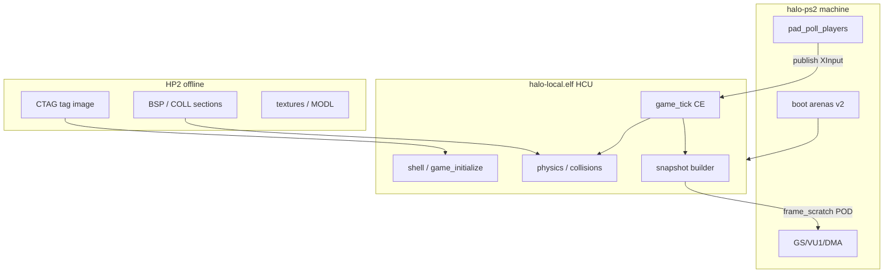

# In-depth milestones plan (M0–M3)

Round 3 integrator output from **17** investigator reports and Round 2 corroboration ([INDEX.md](INDEX.md), [_peer_digest.md](_peer_digest.md), [_conflict_log.md](_conflict_log.md)). This document sequences main-agent work against [plans/5.hcu-remake.md](../../plans/5.hcu-remake.md) exit gates. It does **not** close M0–M3 gates by itself.

**Evidence baseline:** parent `a2575e957feefbdff27febedabf60590401e6bcc`; HCU `c406a4149ddebae4f45462ce4c1e8d9cce0567c2`; reference ELF SHA `e45b4719d35450a77f2a541a7ed8abb877e5fbef495fc918539f8da91de597a2` (regenerate after link changes). Resume context: [plans/remake-cowork.md](../../plans/remake-cowork.md).

---

## Executive summary

| Milestone | Investigation verdict | Main blocker |
|---|---|---|
| **M0** | Link closure measured; ownership frozen in docs | Memory **semantic** sign-off; `result.json` gate tests; doc drift (345 units, 726 externals) |
| **M1** | `halo-local.elf` links; guest reaches `game_initialize` | Platform **R4** cache/file cluster; boot through `game-initialize-done`; pad bridge unwired; ABI/double-helper gate open |
| **M2** | CTAG v1 + partitions specified; retail maps exceed bootstrap caps | No runtime tag image or PS2 cache adapter; arena overlap unmeasured on integrated layout |
| **M3** | CE owns sim/collision/lifecycle; parent is fixture | No post-tick snapshot; `game_tick` not on production path; render **187** stubs break NOTES seam |

**Integrator ordering:** finish **M1 guest boot and cache I/O façade** → **M2 CTAG load + arena routing (C1/C5)** → **M3 tick + snapshot + collision parity (C2/C4)**. Offline converter and host fixtures for M2 can run in parallel with late M1 once boot passes `game-initialize-done`.

---

## Conflict resolutions (Round 3)

| ID | Decision | Rationale (reports) |
|---|---|---|
| **C1** Tag store shape | **Reject** enlarging the bootstrap **2 MiB** tag array to retail size. **Adopt** **CTAG v1** inside HP2 with **partitioned EE owners** (tag structs, BSP/`current_bsp`, MODL/streaming, bitmap/sound staging). Only **`ui`**-class maps may fit a single small resident tag slice. | [m2_arena_capacity_auditor](m2_arena_capacity_auditor.md), [m2_tag_image_format_investigator](m2_tag_image_format_investigator.md), [m0_memory_ledger_auditor](m0_memory_ledger_auditor.md) |
| **C2** Collision path | **Production = HCU** `source/physics/` only. Parent `collide.c` / `pill.c` / `collpack.c` and `world.elf` HP2 packs remain **parity fixtures** until [m3_collision_owner_auditor](m3_collision_owner_auditor.md) §6 checklist passes; then unlink via M6. | [m0_runtime_ownership_auditor](m0_runtime_ownership_auditor.md), [m3_collision_owner_auditor](m3_collision_owner_auditor.md) |
| **C3** Boot vs M2 | **Stage M1 first:** replace or correctly stub **cache + Win32 read/open** on the live path (`game_precache_new_map`, `scenario_tags_load` attempt). **M2** loader/converter proceeds on **host fixtures** in parallel; first **guest** map load is an **M2** exit criterion, not M1. | [m1_platform_callsite_auditor](m1_platform_callsite_auditor.md) §4, [m1_startup_guest_path_auditor](m1_startup_guest_path_auditor.md), [m2_loader_failure_auditor](m2_loader_failure_auditor.md) |
| **C4** Presentation seam | **Bounded presentation adapter** on PS2: advance `render.frame_index` and other **state-advancing** hooks per Halo-64 [NOTES.md](../../submodules/halo-64/port/n64/NOTES.md) seam; **empty** render stubs are not acceptable for sim-affecting calls. **M3** snapshot is read-only consumer input for halo-ps2 draw. | [m1_platform_callsite_auditor](m1_platform_callsite_auditor.md) §5, [m3_snapshot_render_auditor](m3_snapshot_render_auditor.md) |
| **C5** BSS deployment | **Route** `ps2_memory.c` fixed stores through **parent boot arenas** / agreed glue; shrink monolithic `.bss` in the integrated image. Logical v2 ledger remains inventory until physical regions match. Re-run `hcu_ps2_memory_audit.py` after routing. | [m0_memory_ledger_auditor](m0_memory_ledger_auditor.md), [m0_link_closure_auditor](m0_link_closure_auditor.md) |

---

## Architecture (steady state)

---

## M0 — closure and memory (remaining)

**Already satisfied (committed `2879895`):** source/owner direction; 345-unit closure; 0 undefined on linked ELF; HCU collision/identity policy in [docs/source-audit.md](../source-audit.md).

**Close before treating M0 fully signed off:**

1. **Tests:** `result.json` asserts empty `simulation`/`data`/`unclassified` on `rooted.o`; optional `nm -u` link CI ([m0_link_closure_auditor](m0_link_closure_auditor.md)).
2. **Docs:** Align [docs/hcu-ps2-closure.md](../hcu-ps2-closure.md) with live **345** units, **726** live externals, current PROGBITS/BSS sizes ([remake-cowork.md](../../plans/remake-cowork.md)).
3. **Memory gate:** Grouped-owner review for **`render`** (zeroed stub global), **`ai_debug`**, **`audio`** zero-spare — explicit accept or relocate ([m0_memory_ledger_auditor](m0_memory_ledger_auditor.md)).
4. **Do not** close M0 on ledger arithmetic alone without semantic sign-off.

---

## M1 — R5900 port layer (in progress)

### Phase M1-A — Guest boot through local-game init (gate: `game-initialize-done`)

| Step | Action | Sources |
|---|---|---|
| A1 | Fix directory/create path: `CreateDirectoryA` in **`SKIP`** / `ps2_edge.c` or non-fatal `file_create` for `custom_maps` | [m1_startup](m1_startup_guest_path_auditor.md), [remake-cowork](../../plans/remake-cowork.md) |
| A2 | Walk ordered blockers after init: `saved_game_files_initialize` mutex/thread stubs, then first `main_loop` tick | [m1_platform](m1_platform_callsite_auditor.md) **R4** table |
| A3 | PCSX2 boot to **`game-initialize-done`** (or next named halt); update closure doc + plan status from **that** ELF hash | [plans/5.hcu-remake.md](../../plans/5.hcu-remake.md) M1 exit |

**Out of scope for M1 exit:** successful retail map play (M2).

### Phase M1-B — Platform façade (cache / file / time)

| Step | Action | Sources |
|---|---|---|
| B1 | Implement planned **`cache_files_windows.c`** replacement (or equivalent) so **13** cache symbols are not generated **R4** nonsense | [m1_platform](m1_platform_callsite_auditor.md) Appendix A, HCU `port.json` |
| B2 | Win32 **ReadFile** / **CreateFileA** / **Find\*** on map path: fail-closed or real HP2 read — never false success | [m2_loader_failure](m2_loader_failure_auditor.md) |
| B3 | Regenerate `ps2_platform_audit.json`; re-link; pin new ELF SHA | [m0_link](m0_link_closure_auditor.md) |

### Phase M1-C — ABI, pad, DMA prep

| Step | Action | Sources |
|---|---|---|
| C1 | Keep `hcu_ps2_abi_host.py` green; add `projectile.arming_time` to `ps2_abi.c` when touching ABI | [m1_abi](m1_abi_layout_auditor.md), [m1_dma](m1_dma_layout_auditor.md) |
| C2 | **Pad bridge:** `pad_poll_players` → `ps2_input_publish_dualshock` before CE `input_frame_begin` | [m1_pad](m1_pad_multitap_auditor.md), [m3_player_movement](m3_player_movement_auditor.md) |
| C3 | Design snapshot row layout (pointer-free, 16-byte aligned) in `frame_scratch` — design only until M3 | [m1_dma](m1_dma_layout_auditor.md), [m3_snapshot_render](m3_snapshot_render_auditor.md) |
| C4 | Soft-double / FPU gate: track separately; do not block M1 boot on full reduction | [m1_abi](m1_abi_layout_auditor.md), [hcu-ps2-closure.md](../hcu-ps2-closure.md) |

### Phase M1-D — Presentation minimum (C4)

| Step | Action | Sources |
|---|---|---|
| D1 | Identify **R4** render globals tied to timers (`render`, particle toggles) | [m1_platform](m1_platform_callsite_auditor.md) §5 |
| D2 | Minimal adapter: advance `render.frame_index` (and HUD timer hooks if reachable) without full `render.c` | [m3_snapshot_render](m3_snapshot_render_auditor.md), N64 NOTES seam |

**M1 exit gate (remake plan):** ELF boots CE local-game lifecycle; no D3D/DirectSound/Bink/online relocations; PROGBITS reported against `elf_static`; platform services on live path have **real or audited** owners for boot + menu, not false-success cache I/O.

---

## M2 — tag image, loader, arenas

### Phase M2-A — Format and converter (host)

| Step | Action | Sources |
|---|---|---|
| A1 | **CTAG v1:** little-endian image + bounded relocation table → materialized EE pointers | [m2_tag_format](m2_tag_image_format_investigator.md), [hcu-tag-loader-contract.md](../hcu-tag-loader-contract.md) |
| A2 | Keep triple HP2 packs (BSP/OBJ/TEX); add CTAG section — do not fold tag structs into `objpack` alone | [m2_map_conversion](m2_map_conversion_auditor.md) |
| A3 | Fixtures: synthetic tag set + Blood Gulch; determinism + `tag_validate_tags` (real linkage, not PS2 stub) | [m2_loader_failure](m2_loader_failure_auditor.md) |

### Phase M2-B — Load path and fail-closed (guest)

| Step | Action | Sources |
|---|---|---|
| B1 | PS2 `scenario_tags_load` adapter: L0–L6 layered tests (trunc/CRC/reloc OOB/budget) | [m2_loader_failure](m2_loader_failure_auditor.md) |
| B2 | BSP second load into `current_bsp` / CE `global_collision_bsp_get` | [m3_collision](m3_collision_owner_auditor.md), [m2_tag_format](m2_tag_image_format_investigator.md) |
| B3 | Map load/unload returns arena to baseline; no steady-state `malloc` | [plans/5.hcu-remake.md](../../plans/5.hcu-remake.md) M2 |

### Phase M2-C — Capacity and routing (C1, C5)

| Step | Action | Sources |
|---|---|---|
| C1 | Peak overlap table per map class using [tag-index.md](../reports/tag-index.md) + streaming totals | [m2_arena](m2_arena_capacity_auditor.md) |
| C2 | Assign each owner byte to one v2 region; resolve world-arena / ELF overruns in [memory.md](../memory.md) before adding CE bytes | [m0_memory](m0_memory_ledger_auditor.md) |
| C3 | Integrate `ps2_memory.o` with parent arenas; re-audit ELF | **C5** resolution |

**M2 exit gate:** UI then gameplay map load on guest with fail-closed errors; measured high-water within assigned regions (reserve unspent); no heap steady state.

---

## M3 — tick, collision, snapshot

### Phase M3-A — Simulation on CE path

| Step | Action | Sources |
|---|---|---|
| A1 | Run **`game_tick`** at 30 Hz on integrated image; exclude parent `play_ee` diagnostic loop from production path | [m0_runtime](m0_runtime_ownership_auditor.md), [m3_object_lifecycle](m3_object_lifecycle_auditor.md) |
| A2 | Wire pad bridge (M1-C2); CE `collision_move_pill` / `collision_test_*` only | [m3_player_movement](m3_player_movement_auditor.md), [m3_collision](m3_collision_owner_auditor.md) |
| A3 | HCU host harness: §6 parity checklist rows 1–2 (structure BSP / pill) vs parent fixtures | [m3_collision](m3_collision_owner_auditor.md) |

### Phase M3-B — Snapshot and render consume

| Step | Action | Sources |
|---|---|---|
| B1 | Post-tick **immutable** snapshot: handles/generations, transforms, FP pose subset, HUD/effect **requests** | [m3_snapshot_render](m3_snapshot_render_auditor.md), [m3_first_person_pose](m3_first_person_pose_auditor.md) |
| B2 | `sim/objects`, `fpview`, `obj_render` read snapshot only; deprecate parent table as identity | [m3_object_lifecycle](m3_object_lifecycle_auditor.md) |
| B3 | CE state hash invariant across **0 / 1 / N** presentation passes | [m3_snapshot_render](m3_snapshot_render_auditor.md) |

### Phase M3-C — Retirement (pre-M6)

| Step | Action | Sources |
|---|---|---|
| C1 | Keep parent `move`/`pill`/`collide` as oracles until hashes match | [m3_player_movement](m3_player_movement_auditor.md) |
| C2 | Do not link parent collision into HCU ELF | [m3_collision](m3_collision_owner_auditor.md) |
| C3 | Fuel-rod: CE arms-only; drop parent pose hack | [m3_first_person_pose](m3_first_person_pose_auditor.md), remake plan §1 |

**M3 exit gate:** Real movement/collision on CE records; traces match fixtures; snapshot bounded in `frame_scratch` / named regions; render passes do not mutate sim.

---

## Verification matrix (investigator → test)

| Concern | Primary tests / tools |
|---|---|
| Link / stub policy | `tests/test_hcu_ps2_closure.py`, `hcu_ps2_link.py`, proposed `result.json` gate |
| ABI layout | `tools/hcu_ps2_abi_host.py`, R5900 `ps2_abi.o` in closure |
| Platform stubs | `ps2_platform_audit.json` Appendix A tiers; regen after stub owners |
| Pad | `tests/test_hcu_ps2_input.py`, future bridge fixture |
| Tag load | L0–L6 loader tests; converter determinism |
| Arena | `hcu_ps2_memory_audit.py` pinned totals; Blood Gulch peak |
| Movement | `tests/test_move.py`, `test_player.py`, CE `game_tick` hash |
| Collision | [m3_collision](m3_collision_owner_auditor.md) §6 rows → HCU harness |
| Snapshot / render schedule | Parent invariance fixtures + CE hash 0/1/N |

---

## Explicit non-goals (do not do)

- Grow bootstrap **2 MiB** tag cache to fit retail maps (**C1**).
- Link parent **`collide.o` / `collpack.o`** into `halo-local.elf` (**C2**).
- Treat **562** generated stubs as implemented without per-symbol owner (**m1_platform**).
- Use parent **`play_fp` weapon cycling** as CE inventory authority (**m3_first_person_pose**).
- Close M3 on parent-only movement traces without CE `game_tick` hash (**m3_player_movement**).
- Commit M1 before guest lifecycle boot gate passes ([remake-cowork](../../plans/remake-cowork.md)).

---

## Investigation process status

| Round | Status |
|---|---|
| Round 1 | 17/17 reports |
| Round 2 | 17/17 `## Corroboration` |
| Round 3 | This document + conflict resolutions **C1–C5** |

Optional follow-up: one review cycle if implementation diverges from pinned ELF or HCU commit; append addendum section here rather than reopening all 17 reports.

---

## Handoff to implementation (ordered checklist)

1. M1-A guest boot (`custom_maps` / init / `game-initialize-done`).
2. M1-B cache + file façade for precache path.
3. M1-C pad bridge + ABI touch-ups.
4. M1-D minimal render timer adapter (C4).
5. M2-A/B CTAG + loader on host, then guest UI map.
6. M2-C arena routing + memory re-audit (C5).
7. M3-A `game_tick` + CE collision on integrated image.
8. M3-B snapshot builder + halo-ps2 consumers.
9. M3-C parity gates → prepare M4 combat on CE path.

Report issues against investigator IDs in [INDEX.md](INDEX.md); update this plan when exit gates pass or evidence baseline commits change.
