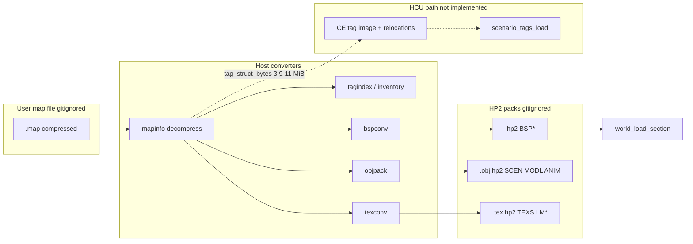

# m2_map_conversion_auditor

## Mission

Audit map conversion input/output, the relationship between Xbox tag-region **model vertex/index buffers** (render payloads stripped for HCU sizing) and **tag-structure bytes**, per-map size ranges from aggregate reports, and the existing HP2 / `halo2ps2` converter toolchain. Report-only; no retail bytes in git; do not claim M2 gates closed.

## Inputs examined

| Source | Role |
|---|---|
| [docs/investigations/_prompt_contract.md](_prompt_contract.md) | Report template, evidence baseline, retail-byte policy |
| [docs/reports/tag-index.md](../reports/tag-index.md) | 24-map tag-region layout, per-map vertex/index/`tag structs` columns |
| [docs/reports/tag-payload-inventory.md](../reports/tag-payload-inventory.md) | Bitmap/sound/script aggregate sizes (not PS2 converted) |
| [docs/hcu-tag-loader-contract.md](../hcu-tag-loader-contract.md) | HCU pointer model vs HP2 presentation packs |
| [config/memory-budget.json](../../config/memory-budget.json) | Parent v2 EE regions used by `convert_map.py` |
| [tools/convert_map.py](../../tools/convert_map.py) | Parent orchestration: decompress, triple pack, determinism, budget checks |
| [submodules/halo-ps2/scripts/build-world.sh](../../submodules/halo-ps2/scripts/build-world.sh) | Upstream three-pack pipeline |
| [submodules/halo-ps2/tools/halo2ps2/](../../submodules/halo-ps2/tools/halo2ps2/) | Converters and parsers (`mapinfo`, `tagindex`, `inventory`, `hp2`, `bspconv`, `objpack`, `texconv`, …) |
| [submodules/halo-ps2/engine/src/stream/hp2.h](../../submodules/halo-ps2/engine/src/stream/hp2.h), [hp2.c](../../submodules/halo-ps2/engine/src/stream/hp2.c) | Runtime HP2 validation/decode |
| [submodules/halo-ps2/engine/src/world/world.c](../../submodules/halo-ps2/engine/src/world/world.c) | Per-section load from `.hp2` via `hp2_open_header` + `hp2_load_stored` |
| [submodules/halo-ps2/docs/02-specs.md](../../submodules/halo-ps2/docs/02-specs.md), [07-hp2-format.md](../../submodules/halo-ps2/docs/07-hp2-format.md) | Budget intent and section tags |
| [docs/milestones.md](../milestones.md) (M09) | Blood Gulch convert metrics (hashes/sizes only) |
| [plans/5.hcu-remake.md](../../plans/5.hcu-remake.md) (M2) | Stated gap: no CE tag-image converter/loader |
| [submodules/halo-ce-universal/port/ps2/include/halo_ps2_limits.h](../../submodules/halo-ce-universal/port/ps2/include/halo_ps2_limits.h) | `HALO_PORT_TAG_CACHE_SIZE` = 2 MiB |

Evidence baseline (contract): parent `a2575e957feefbdff27febedabf60590401e6bcc`; HCU `c406a4149ddebae4f45462ce4c1e8d9cce0567c2`.

Retail maps: referenced only as paths under ignored `data/retail/` ([`.gitignore`](../../.gitignore)); measurements live in `docs/reports/*` only.

---

## Findings

### 1. End-to-end map conversion I/O

#### 1.1 Xbox cache file (input)

- **On-disk**: 2048-byte header + zlib payload for engine v5 Xbox maps (`mapinfo.py`: `HEADER_SIZE`, `is_compressed`, `decompress`).
- **Identity gate** (parent): build `01.10.12.2276`, `engine_name == "xbox"` (`tools/convert_map.py` ~122–124).
- **Tag region**: `MapHeader.tag_data_offset` / `tag_data_size`; index at file offset with Xbox absolute pointers rebased via `XBOX_TAG_BASE` (`mapinfo.py` ~25–26, `tagindex.py` / `tagcache.py`).

#### 1.2 Decompression (intermediate)

| Step | Tool | Output |
|---|---|---|
| Decompress | `mapinfo.py decompress` | Full decompressed `.map` (header + tag region + BSP/media tail) |
| Parent | `convert_map.py` → `run("mapinfo.py", "decompress", …)` | `data/retail/convert/<map>/decompressed/<name>.map` (gitignored) |
| Upstream | User places `assets/decompressed/<map>.map` | `build-world.sh` |

#### 1.3 HP2 packs (output) — three files per map

Both parent and halo-ps2 use the same logical split:

| Pack file | Producer | Primary sections | Runtime consumer (halo-ps2) |
|---|---|---|---|
| `<map>.hp2` | `bspconv.py` | `BSP0`…`BSPZ` (`BSPS` v2 blobs) | `world.c` — BSP geometry, clusters, VU batches |
| `<map>.obj.hp2` | `objpack.py` | `SCEN`, `SKY0`, per-model `MODL`/`OTEX`, `ANIM` | `scen.c`, `model.c`, `anim.c` |
| `<map>.tex.hp2` | `texconv.py` | `TEXS`, per-BSP `LMn` (`LMAP`) | `tex.c` / renderer bindings |

Container: **HP2P** v1, sector-aligned payloads, optional LZ4 (`hp2.py`, `hp2.c`); documented in `07-hp2-format.md`.

**Parent orchestration** (`tools/convert_map.py`):

1. Resolve map via `.local/retail-source.json` (not committed).
2. Decompress once into `data/retail/convert/`.
3. `convert_once`: `bspconv.py`, `objpack.py`, `texconv.py` → three packs.
4. Repeat into `run-a` / `run-b`; require identical SHA-256 per pack.
5. `geometry_error`: BSP vertex order vs source (worst axis error vs declared batch bound).
6. Enforce pack **file** sizes against `config/memory-budget.json` regions: `bsp` → `current_bsp` (6 MiB), `objects` → `resident_gameplay` (~6.5 MiB), `textures` → `texture_cache` (4 MiB).
7. Emit `build/convert/<map>.json` (metadata only; no pack bytes in git).

**Upstream** (`scripts/build-world.sh`): same three converters; optional `objpack` failure is non-fatal (`|| echo`).

#### 1.4 What is *not* in the current convert path

- **No fourth pack** for Xbox **structure BSP collision** bytes as a CE tag image — BSPs are converted to render/collision-oriented `BSPS` sections, not serialized `sbsp` tag blocks for HCU `cache_files.c`.
- **No `SND` / `STR` sections** in parent `convert_map.py` (spec §6 mentions them; converters for sound/strings are not wired in the parent triple-pack flow).
- **No HCU runtime tag image** — converters emit pointer-free PS2 layouts; they do not preserve CE group schemas or `tag_validate_tags` walking (`hcu-tag-loader-contract.md`).

#### 1.5 Runtime load pattern (presentation path)

`world_load_section` (`world.c` ~9–37): read HP2 header only, `hp2_find(tag)`, read stored payload at `offset`, decode to arena allocation, CRC-checked (`hp2_load_stored`). This is independent of HCU `scenario_tags_load`.

---

### 2. Xbox tag region layout (parser contract)

From [tag-index.md](../reports/tag-index.md) (generated by `tagindex.py report` on 24 decompressed maps in `data/retail/weapon-audit-maps/`):

| Field | Offset in index header | Meaning |
|---|---|---|
| Tag array | +0x00 | `base + 0x24` |
| Scenario id | +0x04 | Low 16 bits → `scnr` entry |
| Tag count | +0x0C | Matches array |
| Model parts | +0x10, +0x18 | Equal on all audited maps |
| Model vertex address | +0x14 | Absolute pointer into tag region |
| Model index address | +0x1C | After vertex buffer; index size = gap to first tag data block |

**Layout order** inside tag region: 36-byte index header → tag array → path strings → **vertex buffer** → **index buffer** (16-bit strip indices, `0xFFFF` restarts) → per-tag data blocks ascending (`tagindex.TagIndex.build` ~244–270).

**`sbsp` tags**: entry `data_address` is `0`; BSP bytes live in the map file **outside** the tag region at offsets from scenario references (`tagindex.py` build ~259).

**Indexed external tags**: `indexed` flag 0 on all 24 maps — no resource `.map` sidecars in this inventory.

---

### 3. “Stripped render payloads” vs tag-structure bytes

**Definition used in M2 planning** (`hcu-tag-loader-contract.md`, `tag-index.md`):

- **Render payloads (stripped for HCU tag-cache sizing)**: shared **model vertex buffer** + **model index buffer** embedded in the Xbox tag region (raw `gbxmodel`/`model` geometry before PS2 `MODL` conversion).
- **Tag-structure bytes** (`tag_struct_bytes` in `tagindex.TagIndex.summary` ~296): everything else in the tag region after removing paths, array, and both model buffers:

  `tag_struct_bytes = tag_data_size - (index_end - base)` where `index_end = index_address + index_bytes`.

**PS2 side**: `modelconv.py` reads Xbox `mode` tags and writes **quantized VIF batches** into `MODL` (+ `OTEX`), explicitly **not** copying the Xbox vertex/index pools into HP2 as opaque blobs. `bspconv.py` similarly bakes BSP **render** triangles into `BSPS`. Stripping model buffers from the CE tag image is therefore aligned with “geometry lives in presentation packs,” but **tag_struct_bytes still include** all non-model tag data HCU must retain (AI, weapons, scripts, reflexives, etc.).

**Converter budgets (warnings, not hard fails in all tools)**:

- `bspconv.SIZE_BUDGET` = 7 MiB per BSP section (`bspconv.py` ~49).
- `modelconv.RESIDENT_BUDGET` = 9 MiB for `MODL` (`modelconv.py` ~124).
- `texconv.LM_BUDGET_BYTES` = 512 KiB per BSP lightmap section (`texconv.py` ~82).

These halo-ps2 doc budgets differ numerically from parent `memory-budget.json` (which gates **whole pack files** on Blood Gulch only in CI narrative).

---

### 4. Per-map size ranges (aggregate reports only)

#### 4.1 Tag region decomposition (24 maps, [tag-index.md](../reports/tag-index.md))

| Metric | Minimum | Maximum | Notes |
|---|---:|---:|---|
| **Tag region total** | 6.71 MiB (`hangemhigh`, `prisoner`, `putput`) | 16.21 MiB (`b40`) | UI map `ui`: 1.57 MiB |
| **Tag count** | 983 (`ui`) | 3647 (`b40`) | MP ~1675–1806; campaign ~1860–3369 |
| **Model vertex buffer** | 0.11 MiB (`ui`) | 4.86 MiB (`a30`) | MP ~2.40–2.70 MiB |
| **Model index buffer** | 0.01 MiB (`ui`) | 0.54 MiB (`a30`) | MP ~0.25–0.27 MiB |
| **Vertex + index (render pool in tag region)** | ~2.51 MiB (`putput`: 2.40+0.25) | ~5.40 MiB (`a30`: 4.86+0.54) | Excludes `ui` |
| **Tag structs (after strip)** | 3.93 MiB (`hangemhigh`, `prisoner`) | 10.96 MiB (`b40`) | UI: 1.35 MiB |
| **Structure BSP tag count** | 1 (most MP / `ui`) | 13 (`b40`, `c40`) | Campaign multi-BSP |

**Campaign-only tag structs**: 5.85 MiB (`c20`) … 10.96 MiB (`b40`).  
**Multiplayer (non-UI) tag structs**: 3.93 … 4.14 MiB.  
**Raw tag region (non-UI)**: 6.71 … 16.21 MiB.

Removing **only** vertex+index still leaves **3.93–10.96 MiB** tag-structure bytes — above HCU PS2 `HALO_PORT_TAG_CACHE_SIZE` **0x200000 (2 MiB)** (`halo_ps2_limits.h` ~24). Simply growing the staging array to retail raw size (6.71–16.21 MiB) would also exceed parent `current_bsp` (6 MiB) for large maps without partitioning (`hcu-tag-loader-contract.md`).

#### 4.2 Streamed / non-resident Xbox payloads ([tag-payload-inventory.md](../reports/tag-payload-inventory.md))

These are **referenced pixel/sample bytes in the map file**, not tag-region resident structs, and **not** PS2 converted sizes:

| Payload | Min (map) | Max (map) |
|---|---:|---:|
| Bitmap payload MiB | 18.6 (`ui`) | 56.5 (`d40`) |
| Sound payload MiB | 11.5 (`putput`, `carousel`, …) | 164.5 (`a50`) |
| Script nodes | 0 (MP) | 17,516 (`a10`) |
| Built-in script uses | 0 (MP) | 238 (`d40`) |

Campaign maps carry thousands of `snd!` permutations (e.g. ~7k tags on `a10` per tag-index group table); MP maps ~300–320 sound tags. M2 must not treat these totals as simultaneous EE residency.

#### 4.3 Converted pack sizes (evidence: one map, no bytes in git)

M09 documents **Blood Gulch** only (`docs/milestones.md`):

| Pack | File size (bytes) | Parent budget region |
|---|---:|---|
| BSP | 405,504 | `current_bsp` (6,291,456) |
| Objects | 2,344,960 | `resident_gameplay` (6,815,744) |
| Textures | 350,208 | `texture_cache` (4,194,304) |

Determinism: repeated conversion matching SHA-256; geometry max axis error 0.001114 vs bound 0.001116 over 5503 triangles. **No per-map converted size table exists in git** for the other 23 inventory maps.

---

### 5. HP2 and `halo2ps2` tool inventory

| Module | Function |
|---|---|
| `mapinfo.py` | Header parse, decompress, JSON info |
| `tagindex.py` | Tag index parse/validate, synthetic build, Markdown report (`report`) |
| `tagcache.py` | Alternate tag index + bitmap/sound/script helpers (`report.py`) |
| `inventory.py` | Bitmap/sound/script aggregates → feeds tag-index report |
| `hp2.py` | HP2 build/parse, LZ4 codec |
| `bsp.py` | Locate/read Xbox structure BSP blocks |
| `bspconv.py` | Xbox BSP → `BSPS` HP2 sections |
| `bitmaps.py` | DXT/swizzle decode for textures |
| `texconv.py` | BSP shaders/lightmaps → `TEXS` / `LMn` |
| `scenconv.py` | Scenario placements/defs/lighting → `SCEN` |
| `skyconv.py` | Sky → `SKY0` |
| `modelconv.py` | `mode` tags → `MODL` + `OTEX` |
| `objtex.py` | Object shader textures |
| `animconv.py` | `antr` → `ANIM` |
| `objpack.py` | Bundle object pack |
| `report.py` | Extended per-map Markdown inventory |
| `hsnames.py` | Script builtin names (with XBE path in upstream usage) |

**Tests** (synthetic; optional retail): `submodules/halo-ps2/tools/tests/test_*.py` (12 files). Parent: `tests/test_convert_map.py` (header validation only). Host engine tests decode Python-built HP2 fixtures (`engine/tests/Makefile`).

**Make targets**: parent `make convert` → `tools/convert_map.py`; upstream `make -C engine test` includes HP2/BSP/tex/scen/model/anim round-trips.

---

### 6. Architectural split: presentation conversion vs HCU tag image (M2 gap)

- **Existing**: Left branch — halo-ps2 renderer/world path.
- **Missing for M2**: Right branch — versioned CE tag image with pointer materialization or offset accessors (`hcu-tag-loader-contract.md` §Required decisions).
- **Stripping model vertex/index** reduces raw tag region by ~2.5–5.4 MiB but **does not** bring tag structs under 2 MiB or eliminate need to account BSP collision separately from `current_bsp` HP2 BSP sections.

---

### 7. Ownership vs parent memory budget v2

| Xbox / CE concept | Typical size (reports) | Current owner in repo |
|---|---|---|
| Model vertex/index in tag region | 2.4–5.4 MiB | Stripped → `MODL` in `.obj.hp2` (PS2); not in HCU image |
| Tag structs + scripts + gameplay tags | 3.9–11.0 MiB | **Unowned** in converter output |
| Structure BSP file bytes | Outside tag region; large | `BSPS` in `.hp2` (render-oriented); HCU expects `sbsp` at scenario ref base |
| Bitmap pixels | 18–56 MiB referenced | `TEXS`/`OTEX` (partial; BSP + placed objects) |
| Sound permutations | 11–164 MiB referenced | **No** parent convert output |
| HP2 pack load buffers | Map-specific (BG example above) | Arena regions per `world.c` |

Parent committed EE budget: 33,554,432 bytes total, 5,767,168 reserve (`memory-budget.json`). Converter gate uses three region names only; it does **not** prove fit for `a40`-scale maps or simultaneous HCU tag + HP2 residency.

---

## Interface contracts for the main agent

1. **Input contract**: Decompressed Xbox v5 map, build `01.10.12.2276`, readable tag region per `tagindex.TagIndex.read` validation (paths, monotonic data blocks, model pointer windows).
2. **Presentation output contract**: Three HP2 files per map; sections per `07-hp2-format.md`; CRC + codec ids must pass `hp2_open` / `hp2_load_stored` on EE.
3. **Determinism contract** (parent): `convert_map.py` requires byte-identical packs across two clean output trees for the configured map.
4. **Geometry contract** (BSP pack): Decoded batch vertices match source material order within per-batch declared bounds (`convert_map.geometry_error`).
5. **Size gate contract** (parent, partial): Whole-pack file size ≤ `current_bsp` / `resident_gameplay` / `texture_cache` for the map under test only.
6. **HCU tag image contract** (future, not met): Serialized table + either EE pointers or unified offset accessors; BSP load target explicit; `tag_validate_tags` pass — see `hcu-tag-loader-contract.md`.
7. **Retail hygiene**: Maps and packs under `data/retail/`; reports cite paths and MiB only.

---

## Recommended tests / fixtures

| Priority | Test | Rationale |
|---|---|---|
| P0 | Extend `convert_map.py` or a report script to emit **section raw/stored sizes** for all 24 inventory maps (no bytes committed) | Close gap: only Blood Gulch pack sizes are recorded in docs |
| P0 | Per-map **fail-closed** when `objects` or `bsp` pack exceeds `memory-budget.json` for campaign worst cases (`b40`, `c40`, `a30`) | MP maps are not worst-case |
| P0 | Host fixture: tag image builder rejects **duplicate ownership** (vertex data in both CE image and `MODL`) | M2 partition rule §3 in loader contract |
| P1 | Synthetic `tagindex.TagIndex.build` maps in `test_tagindex.py` + corruption cases | Already partially covered; extend to `tag_struct_bytes` arithmetic |
| P1 | `inventory.py` on each inventory map → compare totals to `tag-payload-inventory.md` | Regression on aggregate reports |
| P1 | Multi-BSP maps: section count `BSP0`…`BSP12` vs `structure_bsps` list in tag-index | `b40`/`c40` have 13 BSPs |
| P2 | Sound convert stub or inventory-only gate before claiming audio streaming | 11–164 MiB source sound |
| P2 | Campaign script node retention in CE image vs stripped presentation | `c20` still 5.85 MiB structs with scripts |

Existing: `make test-host` (12 synthetic converter tests + parent tests); `MAP=bloodgulch make convert` with local retail config.

---

## Dependencies on other investigators

| Investigator | Dependency |
|---|---|
| `m2_tag_image_format_investigator` | CE serialized layout, relocation, versioning |
| `m2_loader_failure_auditor` | Fail-closed paths for malformed HP2 vs malformed tag image |
| `m2_arena_capacity_auditor` | Peak overlap: HP2 decode scratch + HCU tag cache + BSP |
| `m0_memory_ledger_auditor` | Map converted sizes into v2 regions without double-counting streaming |

---

## Open questions

1. **Converted size envelope for campaign maps**: Will `b40` `.hp2` / `.obj.hp2` exceed parent `current_bsp` or `resident_gameplay` when run through `convert_map.py`? Unknown without local runs (not in git).
2. **Collision BSP**: Does `BSPS` embed everything HCU collision needs from `sbsp`, or is a parallel collision extract required? Not answered by presentation converters alone.
3. **Sound path**: Which section format and EE/IOP budget for 7k+ permutations on `a10`? No converter wired in parent pipeline.
4. **Bitmap coverage**: `texconv` inventories BSP shaders; object `OTEX` covers placed models — global UI/shared bitmaps in `ui.map` and campaign-only tags need an explicit ownership list.
5. **HCU + halo-ps2 coexistence**: Can `scenario_tags_load` share nothing with HP2 packs except scenario index/datum identity, or must one authority re-export references for the other?
6. **LZ4 vs stored**: Production packs' codec choice impact on `streaming` region and load times — ADR-012 measurement pending per `07-hp2-format.md`.

---

## Handoff summary

- **Map I/O** is standardized: decompress with `mapinfo.py`, convert to **three HP2 packs** (`bspconv`, `objpack`, `texconv`); parent `tools/convert_map.py` adds determinism, BSP geometry check, and three-region size gates; retail bytes stay gitignored.
- **Stripped render payloads** means Xbox **model vertex + index buffers** (~2.5–5.4 MiB per gameplay map) that PS2 moves into **`MODL`**; **tag_struct_bytes** remain **3.93–10.96 MiB** (MP **3.93–4.14**), far above the **2 MiB** HCU PS2 tag cache cap.
- **Aggregate inventories** in `docs/reports/tag-index.md` and `tag-payload-inventory.md` are the authoritative per-map tables for M2 sizing; they do not replace converted-pack measurements (only Blood Gulch documented in M09).
- **HP2 runtime** validates and decodes sections (`hp2.c`); **world** loads by section tag. This does **not** satisfy HCU `scenario_tags_load`.
- **M2 implementation** still needs a **separate CE tag-image converter/loader** and explicit partition of structs, BSP/collision, render geometry, and streamed media — not an extension of the existing triple-pack pipeline alone.

## Corroboration

### Agreements

- **m2_tag_image_format:** CTAG v1 + reloc table is the CE-side authority; triple-pack pipeline remains parent/world presentation path.
- **m2_arena_capacity:** `tag-index.md` / `tag-payload-inventory.md` sizes match **3.93–10.96 MiB** struct narrative here.
- **m2_loader_failure:** `world_load_section` fail-fast is parallel safety model; CE branch needs same discipline at `scenario_tags_load`.
- **m1_platform / m1_startup:** Map bytes unreachable until cache **R4** stubs replaced — conversion tooling can proceed offline regardless.

### Conflicts

- None on “separate CE tag image” vs HP2 triple pack — complementary pipelines (**C1** is sizing/partition, not pack count).

### Updated handoff

1. Converter outputs: CTAG section + existing BSP/OBJ/TEX HP2 sections; do not fold tag structs into `objpack` alone.
2. Use aggregate reports for sizing gates; per-map converted measurements still required for M2 exit (Blood Gulch first).
3. Keep retail bytes gitignored; document determinism via parent `convert_map.py` checks.
